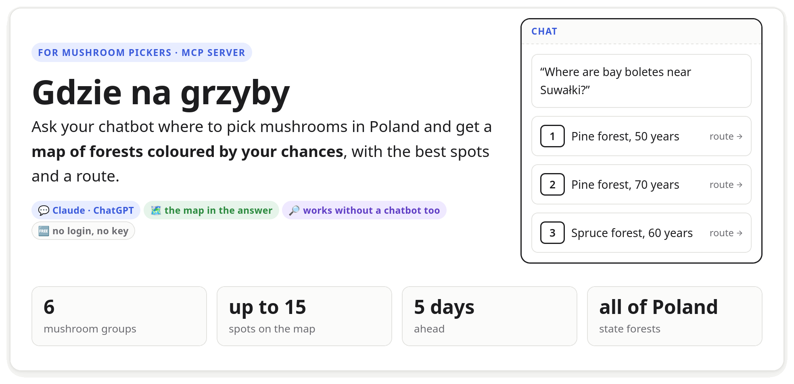
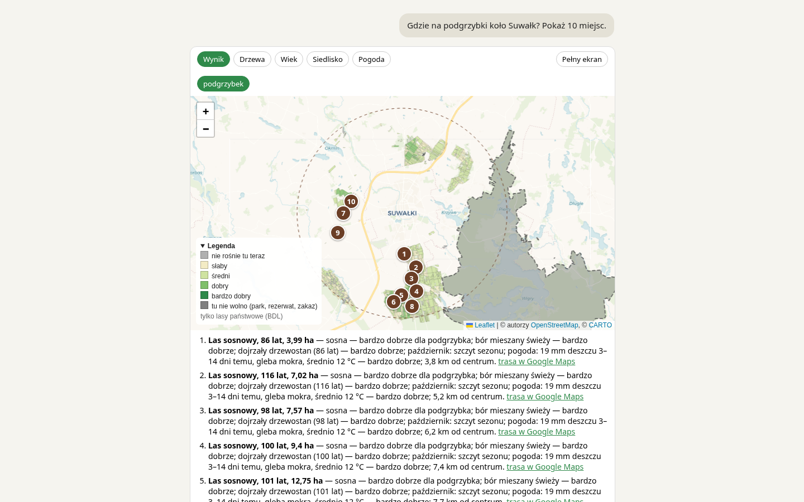
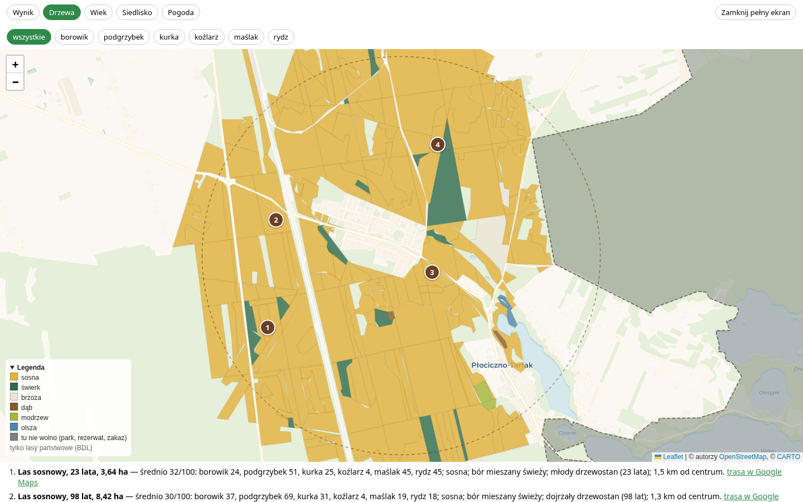
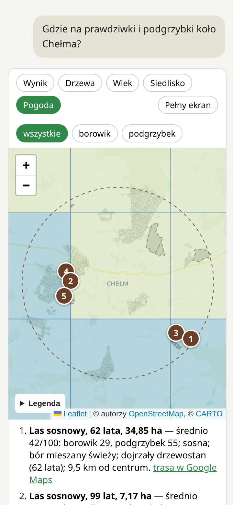
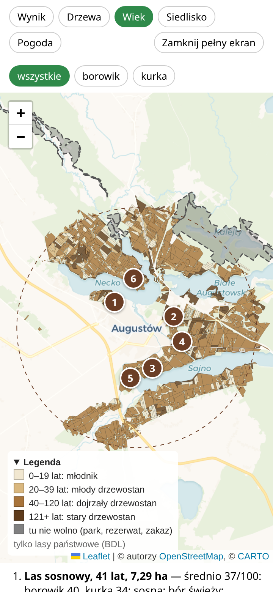
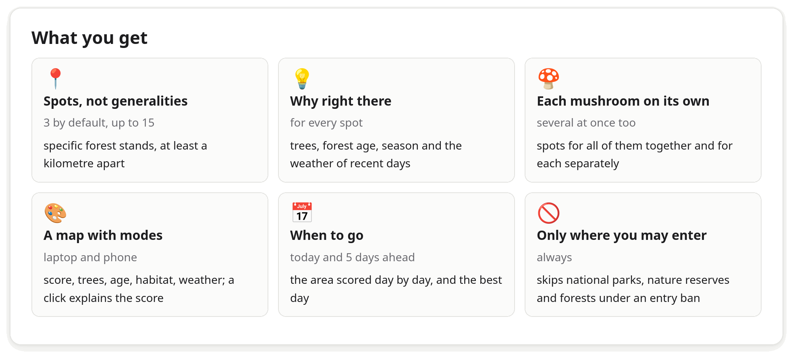
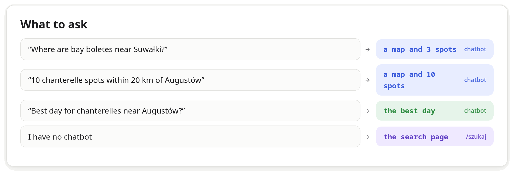
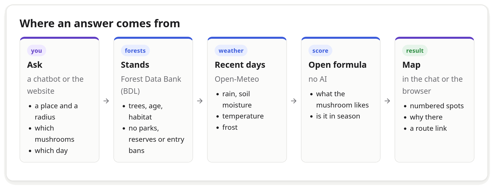

# Gdzie na grzyby

<picture>
  <source media="(prefers-color-scheme: dark)" srcset="docs/visual/board/img/readme/hero-dark.png">
  
</picture>

*Gdzie na grzyby* is Polish for “where to pick mushrooms”. The app, its map and its answers are in Polish.

  
  

## What you get

<picture>
  <source media="(prefers-color-scheme: dark)" srcset="docs/visual/board/img/readme/features-dark.png">
  
</picture>

The mushrooms it knows: borowik (king bolete and its relatives), podgrzybek (bay bolete), kurka (chanterelle), koźlarz
(birch and aspen boletes), maślak (slippery jack) and rydz (saffron milk cap).

<picture>
  <source media="(prefers-color-scheme: dark)" srcset="docs/visual/board/img/readme/choose-dark.png">
  
</picture>

The first question about a new area takes a few seconds, because its forest data is fetched then; after that it is quick.

## Without a chatbot

The same tool runs on a page: **[grzyby.gugnowski.com/szukaj](https://grzyby.gugnowski.com/szukaj)**. Type a place, choose
the mushrooms and get the same map. The search is in the page's address, so a link to it can be saved or sent to a friend.

## Connect it

Server address: **`https://grzyby.gugnowski.com/mcp`**, no login and no key.

Step-by-step instructions (in Polish) are at **[grzyby.gugnowski.com](https://grzyby.gugnowski.com)**, separately for Claude
(claude.ai and the desktop app), ChatGPT and Claude Code, so for an agent in the terminal too.

If the map looks old after a server update, disconnect the connector and connect it again: chatbots remember its old version.

## How it works

<picture>
  <source media="(prefers-color-scheme: dark)" srcset="docs/visual/board/img/readme/flow-dark.png">
  
</picture>

## What it doesn't know

- **State forests only.** Private and municipal forests are blank on the map, not because nothing grows there but because
  there is no data about them.
- **The score is a formula, not an oracle.** It combines what pickers know about each mushroom with the weather of recent
  days. It suggests where to start; you still have to find the mushrooms yourself, and know them.
  Never pick a mushroom you can't identify.
- **Check entry bans on site.** The signs at the forest matter more than the map.

## Data sources

- Forest stands and entry bans: [Bank Danych o Lasach](https://www.bdl.lasy.gov.pl/) (Forest Data Bank, CC BY 4.0).
- National parks and nature reserves: Generalna Dyrekcja Ochrony Środowiska.
- Weather: [Open-Meteo](https://open-meteo.com/) (CC BY 4.0).
- Place locations: Nominatim, © [OpenStreetMap](https://www.openstreetmap.org/copyright) contributors.
- Base map: © OpenStreetMap contributors, © [CARTO](https://carto.com/attributions).

A hobby project: free, no ads, no collecting of data about you.

For developers (in Polish): [docs/dev/README.md](docs/dev/README.md). The pictures in this README are drawn on
`docs/visual/board/readme.html` and rendered with `vdoc.py render` of the suwagent plugin; `just screenshots` takes the map's.
